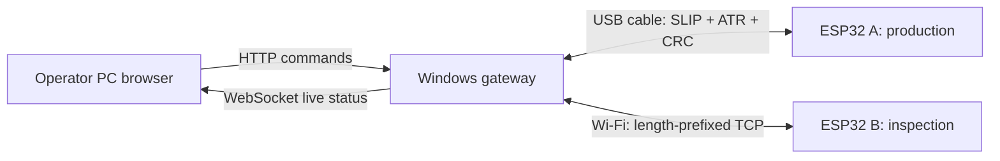

# MCT431 — Production and Inspection Network

We are building a small virtual production line to understand how devices cooperate across industrial communication links. We use two classic ESP32 boards, a Windows gateway PC, and a separate operator PC. Our parts are software records: we do not need motors, sensors, or a conveyor.

This repository implements **Milestone 1** using **ESP-IDF in VS Code**, framed USB serial, custom TCP, HTTP commands, and WebSocket status. We keep the manufacturing model simple so we can follow each command from delivery to acceptance and completion.

## Where we are

- We have implemented both ESP-IDF firmware projects, the Python gateway, the browser interface, and automated software tests.
- We can exercise the workflow using explicitly labelled **simulation** mode.
- We still need to flash our physical boards and complete the hardware demonstration and real packet captures. Software tests do not establish hardware operation.
- We defer formal benchmarking, MQTT, UDP, Modbus, and the final narrative report to the appropriate later work.

## How our system works



We start a batch with its target count, timings, queue capacity, and inspection parameters. The gateway configures both stations over their links. We request one virtual part from A only after reserving space in the queue. A performs its production timer and reports completion. The gateway queues that part and sends it to B when inspection is available. **B computes the verdict** using `(part_id + K) % N == 0`: true means FAIL; otherwise PASS.

We finish only when every requested part has been produced and inspected. We preserve part IDs throughout the path. We distinguish production work, inspection work, and operator commands, each with its own identifier and evidence.

## Find the right file

| Path | What we keep here |
|---|---|
| `config/design.toml` | All gateway defaults: queue size, times, rule parameters, serial/TCP connections, retry and heartbeat settings |
| `config/local.toml` | Optional personal override file; ignored by Git |
| `firmware/production/` | ESP32 A ESP-IDF project |
| `firmware/inspection/` | ESP32 B ESP-IDF project; Wi-Fi credentials set locally in menuconfig |
| `firmware/components/mct_protocol/` | Shared binary format, CRC, ATR, and SLIP |
| `firmware/components/mct_node/` | Shared command validation, duplicate protection, timers, and watchdog |
| `firmware/components/mct_node/include/design_parameters.h` | Firmware link defaults and validation limits |
| `gateway/config.py` | Typed runtime parameters and range validation |
| `gateway/protocol.py`, `transports.py`, `client.py` | Encoding, physical connections, and reliable application exchanges |
| `gateway/controller.py` | Queue, batch lifecycle, and operating states |
| `gateway/app.py`, `static/` | HTTP/WebSocket server and operator interface |
| `gateway/simulation.py` | Software stations for diagnostic testing |
| `tests/` | Python integration tests and portable C firmware-core tests |
| `tools/` | Setup, capture decoding, and Wireshark support |
| `evidence/` | Evidence guide and ignored local run output |
| `.github/workflows/ci.yml` | Gateway tests, native C tests, and both ESP-IDF builds |

## Read in this order

1. [Our concepts and decisions](docs/CONCEPTS.md): terminology and why we need it.
2. [Hardware and deployment](docs/DEPLOYMENT.md): wiring, ESP-IDF/VS Code, hotspot, flashing, and gateway setup.
3. [Architecture and behaviour](docs/ARCHITECTURE.md): queue reservations, states, pause/stop, fault recovery.
4. [Message specification](docs/PROTOCOL.md): exact bytes, identifiers, acknowledgements, and error codes.
5. [Test and demonstration guide](docs/TESTING.md): checks, evidence, and remaining physical validation.

## Try the software workflow on Windows

We use **Python 3.11 or newer** and **ESP-IDF v5.5.1** for reproducible firmware builds. We run the following from this repository's root in PowerShell:

```powershell
py -3 -m venv .venv
.\.venv\Scripts\python.exe -m pip install -r requirements-dev.txt
.\.venv\Scripts\python.exe -m pip install -e . --no-deps
.\.venv\Scripts\python.exe -m gateway --simulate
```

We open `http://localhost:8000` on the gateway or `http://<gateway-hotspot-IP>:8000` on the operator PC. The display explicitly says **SIMULATION**. We wait for both software stations to be online, then start a batch. We do not use simulated records as proof of physical operation.

For the actual boards, we follow [deployment](docs/DEPLOYMENT.md), set the correct COM port and inspection IP in `config/local.toml`, then run:

```powershell
.\.venv\Scripts\python.exe -m gateway --config config/local.toml
```

We run only **one gateway process and one server worker**. We close any serial monitor using A's port before starting it.

## Change a demonstration case

We edit the six batch settings in the browser while Idle, then press Start. These are runtime settings; we do not rebuild or reflash for different queue sizes, durations, N, or K.

| Case | Queue capacity | Production ms | Inspection ms | What we expect |
|---|---:|---:|---:|---|
| Production faster | 2 | 200 | 1000 | Queue fills; production waits for capacity |
| Inspection faster | 4 | 1000 | 200 | Queue remains near empty |
| Minimum queue | 1 | 100 | 500 | Queue never exceeds one waiting part |

For persistent defaults we edit `config/design.toml`, or copy it to ignored `config/local.toml`. Link settings take effect after restarting the gateway. Firmware constants are centralized separately because C firmware and the Python gateway have different build/runtime environments. If we change a shared link constant such as baud rate or TCP port, we update both sides and reflash as needed.

## Reliability we can explain

- We send separate DELIVERED, ACCEPTED, and COMPLETED messages.
- We retry a timed-out request with the **same** identifier and payload, at most three attempts by default.
- We cache the station's most recent response and reject older IDs. We never execute the same accepted command twice in a boot/session.
- We include a gateway session and station boot nonce to reject results from previous runs or reboots.
- We monitor heartbeats. A disconnect during a batch puts the gateway in Fault. We acknowledge the fault with Stop and start a new batch after reconnection.
- We do not resume unfinished batches after gateway restart or ESP reboot. We mark them incomplete in their evidence rather than invent missing results.

Milestone 1 HTTP/TCP access is intended for our isolated lab network. MQTT authentication belongs to Milestone 2; we do not expose this server to the public internet.

## Our evidence and later report

Each gateway run creates `evidence/runs/<UTC timestamp>-simulation/` or `...-hardware/` containing timestamped `events.jsonl` and per-part `parts.csv`. Serial frames are recorded as hex alongside decoded application events. We capture TCP separately in Wireshark.

We keep [decision notes](docs/DECISIONS.md), [the requirement checklist](docs/REQUIREMENTS.md), and [the contribution table](docs/CONTRIBUTIONS.md) as working records. We will write the final report after the milestone, using **we** and a narrative from understanding the concepts through decisions, testing, observations, and conclusions. We do not claim unperformed tests or assign contributions to people who have not confirmed them.

## Verify the software

```powershell
.\.venv\Scripts\python.exe -m pytest -q
```

The GitHub workflow additionally compiles both firmware projects with ESP-IDF v5.5.1 and tests the actual shared C state machine. [TESTING.md](docs/TESTING.md) distinguishes automated checks from remaining hardware acceptance checks.

## Primary references

- [Espressif VS Code extension documentation](https://docs.espressif.com/projects/vscode-esp-idf-extension/en/latest/index.html)
- [ESP-IDF v5.5.1 UART API](https://docs.espressif.com/projects/esp-idf/en/v5.5.1/esp32/api-reference/peripherals/uart.html)
- [ESP-IDF v5.5.1 Wi-Fi API](https://docs.espressif.com/projects/esp-idf/en/v5.5.1/esp32/api-reference/network/esp_wifi.html)
- [SLIP framing, RFC 1055](https://www.rfc-editor.org/rfc/rfc1055)

Our course PDF remains outside this public repository. We use it as the source of requirements; this repository contains our implementation and our own documentation.
