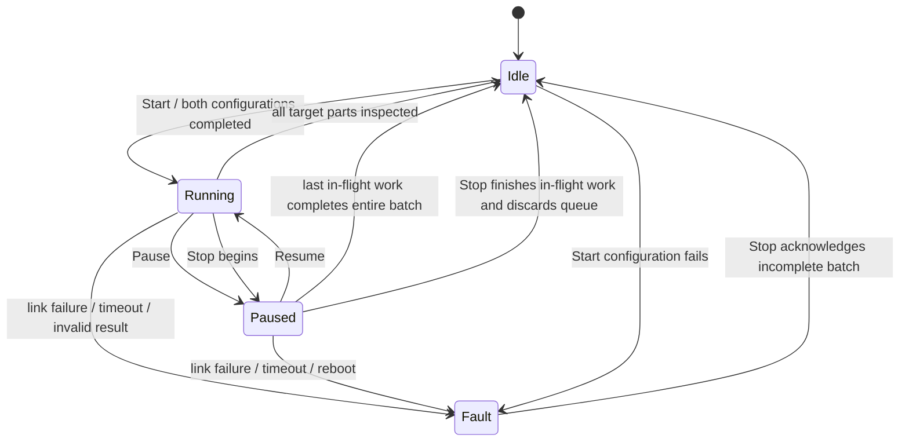

# We coordinate work without losing its meaning

We separate communication from production logic. `protocol.py` defines bytes, `transports.py` moves them, and `client.py` follows each command's lifecycle. `controller.py` owns the batch, queue, and states. `app.py` exposes operator commands and status. Our two firmware projects reuse the same protocol and station state machine.

## Our state diagram

We keep `stopping` as a flag, not a fifth operating state. A batch outcome (`completed`, `stopped`, or `faulted`) remains visible separately from the operating state.

## Queue and production pacing

We use a bounded FIFO waiting queue. Only one production coroutine appends to it. Before requesting a part from A, we require a free slot and reserve it by keeping exactly one `producing` part. Therefore:

`waiting parts + reserved production slot <= configured capacity`

The part already being inspected does not occupy a waiting slot. B receives jobs in queue order. When no slot is available, we stop requesting new production work. We do not drop parts or overflow the queue. A starts its production timer only after receiving a valid PRODUCE job. This makes the configurable cycle time the requested duration of one permitted production cycle; communication overhead and backpressure can reduce the achieved rate.

## Pause and Stop

When we Pause, we stop starting new production and inspection jobs. Work already accepted by a station finishes and its result is retained. A just-finished part occupies its reserved queue slot. Resume continues the same batch and IDs.

When we Stop, we stop starting jobs and wait for current exchanges to complete or exhaust their bounded deadlines. We discard waiting parts and mark the batch `stopped`, with a count of produced parts without verdicts. We never label a partial batch `completed`. Stop may take time for a long in-flight inspection; the interface shows that it is pending.

## Failure, restart, and stale results

Every gateway process generates a random nonzero 64-bit session. Every ESP boot generates a nonzero 32-bit boot nonce. We first receive HELLO and send a BIND command carrying both values. Requests and responses retain them.

We allow one outstanding application command per station. IDs increase within that station/session. A duplicate of the latest accepted request receives its existing acceptance and, if ready, its cached result. An older ID or changed content under the latest ID is rejected. The high-water mark prevents re-execution after cache replacement.

The gateway sends a PING each second. Stations emit HELLO each second. Four seconds without incoming station traffic makes the link unhealthy. A six-second firmware gateway watchdog reboots an abandoned station, clears pending work, and changes its boot nonce. A reconnect, reboot, failed command, or invalid verdict during a batch causes Fault. We require Stop to acknowledge it and a new batch after reconnection.

The gateway rejects mismatched session, boot, operation, command, and part identifiers. A result arriving outside the bounded command deadline is unmatched and cannot create a new verdict. RTT benchmarking is outside Milestone 1.

We intentionally do not promise crash-persistent exactly-once execution: on reboot we invalidate the old session/boot and abandon the incomplete batch. We provide at-most-once execution within a live station boot/session, plus explicit detection and safe handling of restarts.

## Operator commands and observation

HTTP requests contain a UUID `cmd_id`. A response with HTTP 202 means accepted for processing, not completed. We poll `/api/commands/<cmd_id>` for the command's terminal result, and receive system status through `/ws`. Duplicate HTTP requests with identical IDs and content reuse their existing record. Changed content under the same ID returns 409.

We retain up to 4096 operator command records per gateway process, then reject new ones. We do not evict records and accidentally permit duplicate execution. Operator transitions are serialized. For example, a Start can be accepted for processing but fail if the system is already Running; the terminal failure is explicit.

An operator Start and its child CONFIG operations are different commands with different identifiers. Part identity is preserved between production and inspection. We never replace an existing message's identifier merely because it passes through framing or a protocol boundary.

## Why two configuration files exist

`config/design.toml` contains gateway and runtime batch defaults. `design_parameters.h` contains compile-time firmware limits and link constants. We keep each set in one place rather than scattering literals across modules. The browser overrides batch settings at runtime. ESP32 B's Wi-Fi credentials belong in the local ESP-IDF configuration, which is ignored by Git.
